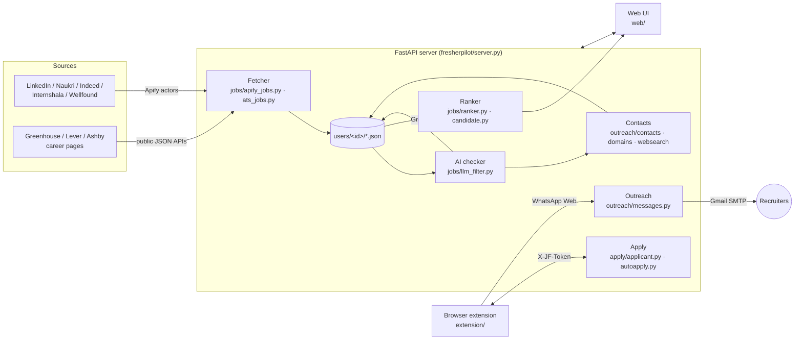
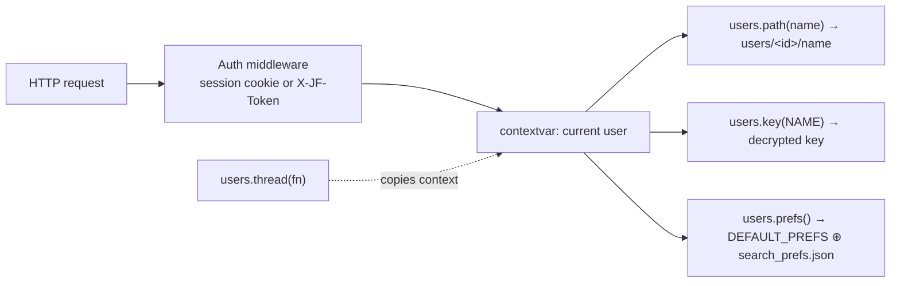

# Architecture

FresherPilot is a single-process local web app:

- a **FastAPI** server that keeps all state in JSON files, one folder per user;
- **background threads** for fetching jobs, AI checks and contact search;
- a **vanilla-JS UI** served by the same server;
- a **browser extension** that acts inside job sites using the user's own logins.

There is no database, no build step and no cloud backend.

## 1. System overview



## 2. Job pipeline

Each stage is cheaper than the next, so expensive work only runs on jobs that survived the cheap
stages.

```mermaid
flowchart TD
    S[Search inputs<br/>roles · cities · time window · fresher filters] -->|board-side filtering<br/>= fewer paid results| B[Apify actors + career pages]
    B --> N[Normalize per board<br/>common job schema]
    N --> L{Location check<br/>free}
    L -- other city --> X1[dropped]
    L --> M[Merge + dedupe<br/>title|company, keep 21 days]
    M --> T{Title rules<br/>TITLE_EXCLUDE, free}
    T -- senior / intern / off-stack / non-dev --> X2[rejected]
    T --> PS[AI title pre-screen<br/>60 titles per call]
    PS --> J[AI fact extraction<br/>judge_jobs: type, min years,<br/>seniority, role, freshers ok]
    J --> DEC{decide&#40;&#41;<br/>user prefs in code}
    DEC -- 1 yr + internships mentioned --> IC[judge_intern_credit]
    IC --> DEC
    DEC -- rejected --> X3[hidden, reason kept]
    DEC --> FIT[judge_fit<br/>strong / partial / none]
    FIT --> RK[Embedding rank<br/>bge-small vs resume]
    RK --> INS[judge_instructions<br/>special how-to-apply]
    INS --> UI[Job list / dashboard]
```

**Design rules**

- **The AI extracts facts and code makes the decisions.** The LLM only reports what a posting says,
  for example "minimum 2 years, full-time". `decide()` then applies the user's preferences. Changing
  a preference never needs new AI calls, and the decisions are testable (`scripts/check_filter.py`).
- **Free filters run before paid ones**, in this order: board-side filters (cheaper scraping), title
  rules and location check (no tokens), AI.
- **Every verdict is cached** in `llm_verdicts.json`, so each job is judged once.
  `cached_verdict()` re-applies `decide()` with the user's current prefs.

## 3. Fetching and cost control

| Mechanism | Where | Effect |
|---|---|---|
| Daily budget = Apify credit left ÷ days left in cycle | `_apify_allowance()` | $5/month lasts the month |
| Per-board share of the daily budget | `BUDGET_SHARE` | LinkedIn 45%, Naukri 25%, Indeed 12%, … |
| Spending cap per actor run | `max_charge_usd` / caps | a run stops at its cap; results are sorted newest first |
| Time window = since this board's last fetch (+2 h) | `_window_hours()` | jobs aren't bought twice |
| Incremental modes / `skipJobId` | Naukri, Internshala, Wellfound / LinkedIn | already-seen jobs aren't charged |
| Location in search inputs | `_input_for()`, `_run_linkedin()` | only the chosen cities are fetched |
| Concurrency ≤ 4 runs | `_ACTOR_SLOTS` | stays under Apify free plan's limit of 5 |
| Wellfound once per day | `fetch_latest_jobs()` | it charges a start fee per run |

LinkedIn runs as one search per (title × city) pair, in two waves. The second wave skips job IDs
the first wave already found.

## 4. AI layer (`fresherpilot/jobs/llm_filter.py`)

- `_create()` is the single wrapper for every Groq call. It provides:
  - model fallback `gpt-oss-120b → gpt-oss-20b → qwen` when a model's daily quota runs out;
  - low reasoning effort;
  - JSON-schema output (plain JSON mode for qwen);
  - a guard against empty answers.
- Token use is logged per user in `ai_usage.jsonl` and shown in the UI.
- When every model is rate-limited, jobs stay *pending* and the checker retries later.

## 5. Multi-user model (`fresherpilot/core/users.py`)



- **Accounts:** passwords are stored as salted hashes. API keys are encrypted (Fernet) with a key
  derived from the user's password, and are decrypted in memory only while the user has a session.
- **Data isolation:** every data file is reached through `users.path()`, so each user gets their own
  jobs, verdicts, embeddings, profile, resume, applications and logs.
- **Background threads** start through `users.thread()`, which keeps the user context. Per-user task
  state lives in `_T()` in `server.py`.
- **The first account is the owner.** It takes over pre-account root files and `.env` keys. Other
  users never fall back to `.env`.
- **Shared caches** hold only non-personal data: the company contacts cache.

## 6. Browser extension (`extension/`, MV3)

| File | Role |
|---|---|
| `bridge.js` | content script on the app page; passes the app's `extension_token` to the background (`jf-set-token`) |
| `content.js` | reads form fields (label, type, options, limits) and fills them with answers from `/api/autofill` |
| `agent.js` | snapshots a job page: visible text, clickable elements with key labels, dialogs, login/CAPTCHA detection |
| `background.js` | auto-apply loop and WhatsApp Web runner |
| `popup.html/js` | "Fill this page" button |

**Auto-apply loop:**

1. `background.js` opens the job in a tab and sends a page snapshot to `/api/autoapply/decide`.
2. `autoapply.py` returns the next action: click, fill, wait, pause or done. Obvious single
   Next/Submit buttons need no AI call.
3. The extension performs the action and repeats.
4. Sign-in, CAPTCHA or unanswerable questions pause the loop. The user resolves them, then presses
   Continue in the app or the tab.

## 7. API surface (`fresherpilot/server.py`)

| Group | Endpoints |
|---|---|
| Pages | `/`, `/login`, `/onboarding`, `/account` |
| Auth & account | `/api/auth/{state,register,login,logout}`, `/api/me`, `/api/account/{keys,prefs,password}` |
| Onboarding | `/api/onboarding/{resume,save}` |
| Jobs | `/api/jobs`, `/api/fetch`, `/api/status`, `/api/usage`, `/api/visited`, `/api/contacts` |
| Applying | `/api/profile`, `/api/resume`, `/api/autofill`, `/api/applykit`, `/api/application` |
| Auto-apply | `/api/autoapply`, `/api/autoapply/{decide,event,command}` |
| Outreach | `/api/outreach`, `/api/outreach/{settings,send,event,job}` |
| Dashboard | `/api/dashboard` |

The UI polls `/api/status` (≤ 3 s, below uvicorn's 5 s keep-alive) for fetch and checker progress.

## 8. Data files (per user, `users/<id>/`)

| File | Contents |
|---|---|
| `search_prefs.json` | roles, cities, skills, off-stack words, experience, LinkedIn titles |
| `keys.enc` | encrypted API keys |
| `resume.pdf`, `applicant_profile.json` | resume and form-filling profile |
| `jobs_cache.json` | merged jobs, per-board fetch times, Apify spend log, fetch report |
| `llm_verdicts.json` | cached AI facts per job |
| `embeddings_cache.npz` | job embeddings |
| `applications.json`, `visited.json` | tracking |
| `applykit_cache.json` | generated cover letters and answers |
| `autoapply_log.jsonl`, `outreach_log.json`, `ai_usage.jsonl` | logs |
| `outreach_settings.json` | message templates and settings |

## 9. Known limits and next steps

- JSON files rather than a database: fine for one machine and a few users, not for hosting.
- `server.py` holds all endpoints; splitting it into FastAPI routers per area would help as it grows.
- Scraping depends on third-party Apify actors whose inputs can change.
- Auto-apply on LinkedIn / Naukri / Indeed is against their terms. Keep volumes low.
